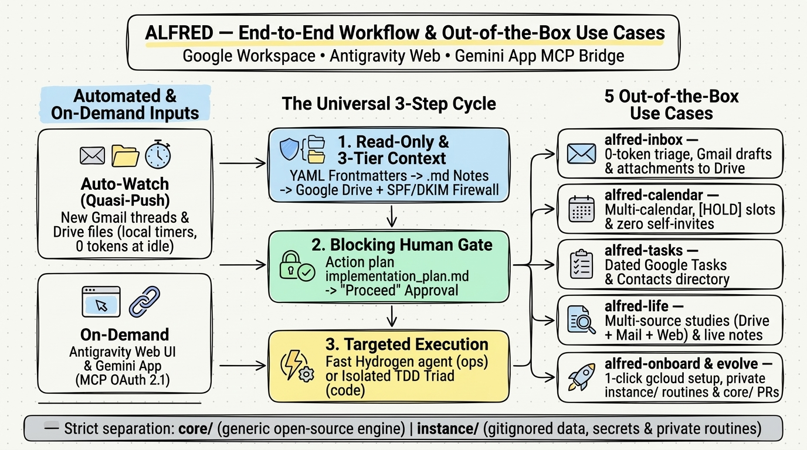

# Alfred V8.0 — Family Office Chief of Staff

Outil personnel **gratuit et open-source** combinant **Antigravity Web**, des commandes Python locales sur Google Workspace et un **pont MCP OAuth 2.1 pour Gemini App**.



---

## Pourquoi Alfred (face à Gemini App seul) ?

1. **Workflows constants sans re-validation permanente** : Alfred applique systématiquement le cycle *lecture seule $\rightarrow$ plan validé $\rightarrow$ exécution*, sans devoir redonner manuellement les mêmes instructions ni les autorisations à chaque étape.
2. **Interrogation automatique des APIs en tâche de fond (quasi-push)** : des routines périodiques locales vérifient les nouveaux e-mails, agendas et fichiers Drive à intervalle régulier — par exemple un e-mail entrant est déjà trié, classé et son brouillon préparé dès son arrivée, avant même d'ouvrir une conversation.

Le dépôt suit une séparation stricte entre **`core/`** (cœur générique open-source) et **`instance/`** (données, secrets OAuth, routines et configuration personnelle gitignorés). Voir la spécification complète dans [docs/SPEC.md](docs/SPEC.md).

---

## Installation en une commande

```bash
git clone https://github.com/<owner>/alfred-core.git ~/Alfred && cd ~/Alfred && ./scripts/bootstrap.sh --onboard
```

`./scripts/bootstrap.sh --onboard` prépare `instance/` (gitignoré), crée l'environnement Python `.venv`, active les hooks Git `.githooks/` puis lance `alfred bootstrap-gcp --finish-setup`.

---

## Configuration Google Cloud pas-à-pas

**Ce que `alfred bootstrap-gcp` fait 100 % automatiquement :**
- Installe localement le SDK `gcloud` dans `~/.local/google-cloud-sdk` (sans `sudo`, Linux `x86_64` / `aarch64`) ;
- Ouvre la connexion compte Google via `gcloud auth login --no-launch-browser` (compatible SSH) ;
- Crée ou sélectionne le projet GCP et active uniquement les APIs requises par vos drapeaux (`gcloud services enable`).

**Les 2 étapes navigateur guidées par les liens `?project=<project_id>` affichés dans le terminal :**
1. **Google Auth Platform $\rightarrow$ Audience** : sélectionnez le type *External* (ou passez en *Testing* si demandé), puis dans **Test users** cliquez **`+ Add users`**, saisissez votre adresse Gmail et cliquez **`Save`**.
2. **Clients $\rightarrow$ `+ Create client`** : choisissez **`Desktop app`**, nommez le client (`Alfred`), cliquez **`Create`** puis **`Download JSON`**.
3. **Collage direct en SSH** : copiez le contenu du fichier téléchargé et collez-le dans le terminal (aucun transfert `scp` requis ; écriture `0600` dans `instance/secrets/`), puis validez l'URL OAuth affichée par `alfred auth-google --no-browser`.

| Module (`features.*`) | Défaut | APIs GCP activées | Scopes OAuth2 (`https://www.googleapis.com/auth/...`) |
| :--- | :---: | :--- | :--- |
| `drive_knowledge_sync` | `true` | `drive`, `sheets` | `drive` |
| `inbox_auto_triage` | `true` | `gmail` | `gmail.modify`, `gmail.compose`, `gmail.settings.basic` |
| `gmail_drafts_and_send` | `true` | `gmail` | `gmail.modify`, `gmail.compose`, `gmail.settings.basic` |
| `calendar_management` | `true` | `calendar-json` | `calendar` |
| `tasks_management` | `true` | `tasks` | `tasks` |
| `contacts_lookup` | `true` | `people` | `contacts`, `contacts.other.readonly` |
| `google_docs_suite` | `false` | `docs`, `sheets`, `slides`, `forms` | `documents`, `spreadsheets`, `presentations`, `forms.body`, `forms.responses.readonly` |
| `signature_delegation` | `false` | Local (aperçu PDF seul) | Aucun (signature humaine hors-bande) |
| `mcp_gemini_bridge` | `false` | Local (`127.0.0.1:8765`) | Aucun (OAuth 2.1 PKCE `S256` + PIN PBKDF2) |

---

## Les 6 Workspaces & Usage Quotidien

| Workspace | Rôle | Modèle | Exécution après validation (`Proceed`) |
| :--- | :--- | :--- | :--- |
| `alfred-onboard` | Diagnostic, flags modulaires, OAuth2 & taxonomie Drive | `gemini-pro-orchestrator` | `plan-executor` (`Hydrogen`) |
| `alfred-life` | Hub général, études multi-sources & pont MCP | `gemini-pro-orchestrator` | `plan-executor` (`Hydrogen`) |
| `alfred-inbox` | Triage e-mails, pièces jointes Drive & brouillons `sendAs` | `gemini-4-hydrogen-medium` | `plan-executor` (`Hydrogen`) |
| `alfred-calendar` | Multi-calendriers, `[HOLD]` allowlistés & FreeBusy | `gemini-4-hydrogen-medium` | `plan-executor` (`Hydrogen`) |
| `alfred-tasks` | Google Tasks (RFC 3339) & Google Contacts | `gemini-4-hydrogen-medium` | `plan-executor` (`Hydrogen`) |
| `alfred-evolve` | Évolutions `instance/`, `local-fork` ou PR `upstream-pr` | `gemini-pro-orchestrator` | Triade `tdd-red` -> `tdd-green` -> `tdd-verifier` |

```bash
.venv/bin/alfred status-onboarding --json
.venv/bin/alfred scan-knowledge && .venv/bin/alfred poll-inbox --spawn-agy --cognitive-agy
.venv/bin/alfred list-calendars && .venv/bin/alfred list-tasks
.venv/bin/alfred install-routines && .venv/bin/alfred status-routines
```

---

## Règle d'Évolution (`--mode instance` vs `upstream-pr` vs `local-fork`)

1. **`--mode instance` (par défaut pour le personnel)** : routines et configuration cantonnées à `instance/` (`instance/extensions/*.py`, `settings.yaml`). Zéro PR et `docs/SPEC.md` inchangé.
2. **`--mode upstream-pr`** : évolution générique de `core/` (ou exemple anonymisé dans `instance/examples/`). Exécutée en `git worktree` isolé avec synchronisation automatique de [docs/SPEC.md](docs/SPEC.md) (`sync-spec`), règle *Zéro demi-morceau dans `core/`* (`--hybrid --core-complete`), détection `[BREAKING]` et fallback fork GitHub.
3. **`--mode local-fork`** : modification locale de `core/` committée sur `evolve/<id>` sans PR amont.

---

## Pont MCP Externe vers Gemini App (HTTPS / TLS)

```bash
.venv/bin/alfred apply-onboarding --enable mcp_gemini_bridge --mcp-public-url "https://alfred.domaine-perso.example"
.venv/bin/alfred setup-mcp --pin "<PIN>" && .venv/bin/alfred install-routines
```

- **Option A — Cloudflare Tunnel (`cloudflared`)** : exposer `https://alfred.domaine-perso.example` vers `http://127.0.0.1:8765` (ou `--mcp-host 0.0.0.0` sur LAN), sans Cloudflare Access OTP, avec règle WAF *Skip* sur `/.well-known/*`, `/oauth/*` et `/mcp`.
- **Option B — Reverse Proxy TLS (Caddy / Nginx, port `443`)** : proxy HTTPS TLS vers `127.0.0.1:8765` sans buffering (`X-Forwarded-Proto`, `Host`). Connecter `https://alfred.domaine-perso.example/mcp` dans Gemini App avec votre `<PIN>`.

---

## Gardiens Déterministes

```bash
.venv/bin/python core/scripts/check_code_architecture.py --repo-root .
bash core/scripts/check-upstream-leak.sh .
.venv/bin/ruff check core && .venv/bin/mypy --strict core/alfred core/scripts core/tests
.venv/bin/pytest --cov=core --cov-fail-under=90 && .venv/bin/alfred sync-spec --check --repo-root .
```
