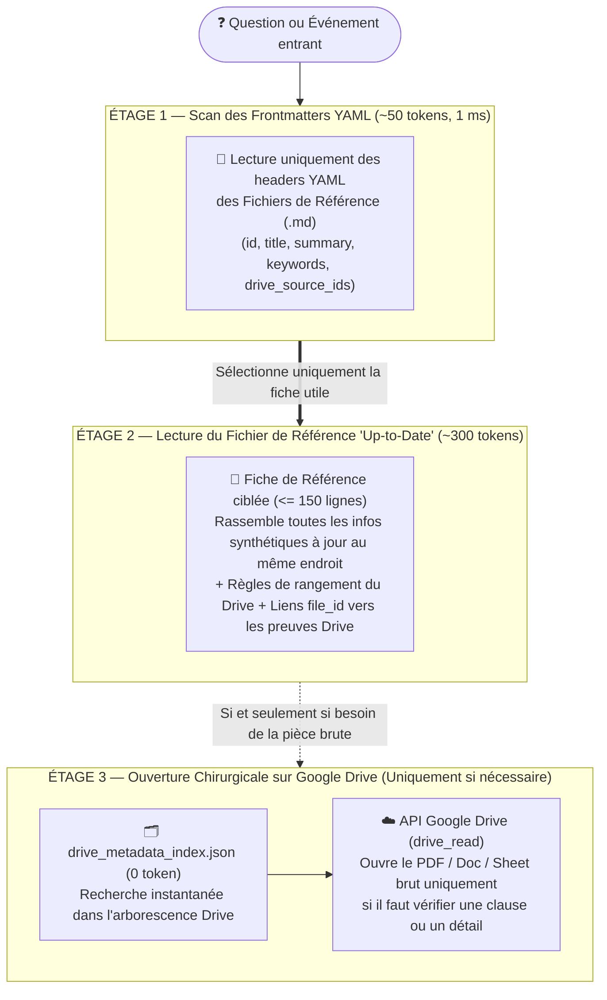
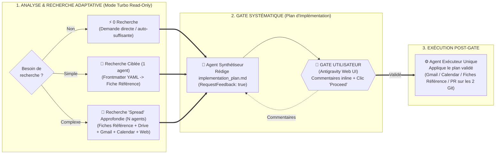

# 🎩 Projet "Alfred — Personal Chief of Staff" (Version 7.1 Lean)
## Architecture Épurée 100 % Antigravity Web, Connaissance 3-Tiers (Frontmatter YAML + Google Drive) & Gate Systématique `implementation_plan.md`

> **Racine du Projet** : `/root/Alfred` (`ALFRED_ROOT_DIR`, Project ID : `a1f8ed00-0000-4000-8000-000000000001`)  
> **Principe Directeur V7.1 Lean** : **Zéro Usine à Gaz, Efficacité Maximale en Tokens**.
> - **100 % Antigravity Web UI** (mono-utilisateur, zéro Google Chat, zéro WebApp externe, zéro finance/impôts/patrimoine complexe).
> - **Architecture de Connaissance Hybride en 3 Étages** :
>   1. **Fichiers de Référence *Up-to-Date* (`.md` avec Frontmatter YAML)** : rassemblent les informations synthétiques à jour au même endroit et permettent un chargement progressif ultra-économe en tokens (exactement comme les `skills/`).
>   2. **Index Local & Règles de Rangement Google Drive (`drive_metadata_index.json` + `00_drive_taxonomy_and_filing_rules.md`)** : construits au *First-Run* en analysant l'exhaustivité de ton Google Drive pour savoir exactement où et comment tes documents sont rangés.
>   3. **Documents Officiels Bruts sur Google Drive (`drive_read`)** : tes PDF, contrats et factures restent rangés à ta façon sur Google Drive et ne sont ouverts via l'API Drive que lorsqu'un détail de pièce source est requis.

---

## 1. Comment Articulons-Nous les `Frontmatters YAML`, les `Fichiers de Référence Up-to-Date` et `Google Drive` ?

Tu as soulevé deux points fondamentaux dans tes commentaires :
1. *« Quid du sujet des frontmatters ? Ces derniers permettent de vraiment gagner en efficacité sur des fichiers `.md`. Ça ne sert à rien si on fait du Google Drive ? »*
2. *« Il serait intéressant d'avoir au moment du scaffolding du projet (initialisation au first run) d'analyser l'EXHAUSTIVITÉ du Drive et de définir les règles de comment sont rangées les choses afin de mieux comprendre où sont les data et comment elles sont rangées. Par ailleurs, conserve-t-on un mécanisme de fichier de référence que l'on crée afin de rassembler plein d'infos "up2date" au sein d'un même endroit ? »*

### 1.1. La Réponse : La Distinction entre « Documents Bruts (Drive) » et « Fiches de Référence *Up-to-Date* (`.md` à Frontmatter YAML) »

Si Alfred n'avait que tes PDF et documents bruts éparpillés dans Google Drive, il devrait, à chaque question, rouvrir 4 ou 5 gros PDF de 20 pages sur Drive (ce qui coûterait **5 000 à 10 000 tokens** à chaque fois).
À l'inverse, l'erreur de l'ancienne V6 était de vouloir convertir des `.md` en Google Docs éditables avec une synchro bidirectionnelle complexe.

En **V7.1 Lean**, on combine le meilleur des deux mondes sans aucune usine à gaz grâce au **Chargement Progressif en 3 Étages (inspiré des `skills/`)** :

1. **Oui, on conserve les Fichiers de Référence *Up-to-Date* en `.md` avec Frontmatter YAML obligatoire (`instance/data/knowledge/*.md`, sauvegardés tels quels en `.md` sur Google Drive)** :
   - Leur rôle est de **rassembler au même endroit toutes les informations synthétiques à jour** sur un sujet donné (avec les `file_id` pointant vers les documents originaux dans ton Drive).
   - Grâce au **Frontmatter YAML** en tête de chaque fichier `.md`, les agents chargent d'abord uniquement les quelques lignes du frontmatter (~50 tokens), identifient la bonne fiche, et ne chargent le corps complet que si nécessaire.
   - Comme ces fichiers restent de vrais fichiers `.md` (sauvegardés en `.md` dans un dossier `_ALFRED_REFERENTIEL_` sur ton Drive en backup unidirectionnel), il n'y a **aucune moulinette de conversion Google Docs** et **0 conflit de synchronisation**.

2. **Au First-Run (`init-drive`) : Analyse Exhaustive de ton Google Drive & Création des Règles de Rangement** :
   - Lors de la première initialisation du projet, un essaim d'agents en mode Turbo parcourt **l'exhaustivité de l'arborescence de ton Google Drive** (dossiers, sous-dossiers, noms des fichiers, types, dates) et génère :
     - **`00_drive_taxonomy_and_filing_rules.md` (avec Frontmatter YAML)** : la carte maîtresse expliquant **comment tu ranges tes affaires dans ton Drive** (où sont rangés les contrats, les papiers administratifs, les documents liés à l'enfant/nounou, quelle logique de dossiers et de nommage tu utilises) et quelles informations clés doivent être suivies dans les fiches de référence. Ce fichier t'est soumis dans un **`implementation_plan.md`** au First-Run pour que tu puisses le valider ou l'annoter.
     - **`drive_metadata_index.json`** : l'index local ultra-rapide de tous tes fichiers et dossiers Drive, maintenu à jour automatiquement par delta (`drive.changes().list` à 0 token).

3. **Les Fichiers de Référence *Up-to-Date* Initiaux (`instance/data/knowledge/`)** :
   - `00_drive_taxonomy_and_filing_rules.md` : Cartographie de ton Drive et règles de rangement.
   - `01_profil_et_contacts_cles.md` : Contexte essentiel, contacts fréquents et style/ton relationnel appris au fil de l'eau.
   - `02_assistante_maternelle.md` : Synthèse *up-to-date* du contrat signé de la nounou, horaires, tarifs, solde de congés, préavis et liens vers le contrat PDF sur Drive.
   - `03_dossiers_actifs_et_administratif.md` : Synthèse *up-to-date* des sujets administratifs ou contrats actifs que tu consultes ou mets à jour.

---

## 2. Le Pattern Universel en 3 Étapes (Avec Recherche Adaptative & Gate `implementation_plan.md`)

Dans tous les workspaces (`alfred-inbox`, `alfred-calendar`, `alfred-life`, `alfred-evolve`), la méthode suit toujours les **3 mêmes étapes**, mais **la séquence exacte de l'Étape 1 s'adapte intelligemment à la question posée** :

1. **Étape 1 — Analyse & Recherche Adaptative en Mode Turbo (`Read-Only`)** :
   - Selon la question posée :
     - Si aucune recherche n'est utile $\rightarrow$ passage immédiat à la rédaction du plan.
     - Si une vérification rapide suffit $\rightarrow$ lecture des Frontmatters YAML et de la fiche de référence *up-to-date*.
     - Si la question exige une recherche approfondie $\rightarrow$ lancement en parallèle (« Spread ») de plusieurs sous-agents en mode Turbo (`research-drive`, `research-gmail-cal`, `research-web`) pour explorer le Drive, les mails, l'agenda et Internet.
2. **Étape 2 — Synthèse & Gate Systématique (`implementation_plan.md`)** :
   - Rédaction de **`implementation_plan.md`** (`RequestFeedback: true`). C'est une **Gate bloquante systématique** avant toute action d'écriture.
3. **Étape 3 — Exécution par un Dernier Agent Unique** :
   - Une fois la Gate validée, un dernier agent exécute le plan (et met à jour si besoin la Fiche de Référence `.md` correspondante pour qu'elle reste *up-to-date*).

---

## 3. Les 3 Cas d'Usage Fonctionnels au Quotidien

### 3.1. `alfred-inbox` : Routine sur les Nouveaux E-mails à 3 Sorties Exclusives
- **Pas de reprise des anciens e-mails** : Seuls les nouveaux messages à partir du `historyId` courant sont traités.
- **Les 3 sorties** :
  1. **`SILENT_NO_ACTION`** : Bruit, pubs, et notifications passives de portails (*« Vous avez de nouveaux documents réglementaires sur votre espace Generali »*, factures d'abonnement courantes sans anomalie) $\rightarrow$ **0 action dans Gmail** + **la conversation Antigravity est automatiquement archivée**.
  2. **`DRAFT_REPLY` (Brouillon de réponse)** : Crée le brouillon dans Gmail, garde la conversation Antigravity Web **allumée**, et écrit dans **`implementation_plan.md`** le contenu du brouillon pour que tu puisses le corriger avec des commentaires inline avant mise à jour / envoi.
  3. **`USER_ACTION_REQUIRED` (Action à réaliser par toi)** : **Starre automatiquement (`STARRED`)** l'e-mail dans Gmail, garde la conversation Antigravity Web **allumée**, et livre dans **`implementation_plan.md`** un **défrichage complet de ce que tu dois faire** (documentation cherchée sur Internet, pièces retrouvées dans Drive via l'index et les fiches de référence, contexte des mails).

### 3.2. `alfred-calendar` : Assistante Maternelle (`Garde Nounou`)
- **Initialisation sur le Contrat Signé** : Analyse du contrat signé $\rightarrow$ Gate `implementation_plan.md` $\rightarrow$ création du calendrier Google **`Garde Nounou`** + création de la fiche de référence *up-to-date* `02_assistante_maternelle.md` (avec Frontmatter YAML) et `nounou_contract.json`.
- **Le 20 du mois $M$** : Pré-remplissage automatique du mois $M+1$ avec les horaires exacts du contrat.
- **Vacances & Préavis (~1 mois)** : Détection des vacances posées et rappel du préavis contractuel via `implementation_plan.md`.
- **À J-3 / J-4 de la fin du mois (`last_day - 3`, février inclus)** : Calcul du récapitulatif mensuel Pajemploi soumis dans `implementation_plan.md`.

### 3.3. `alfred-life` & `alfred-evolve` (Avec Génération de PR sur les 2 Dépôts Git)
- **`alfred-life`** : Toutes tes questions et demandes traitées via le Pattern 3 Étapes (Recherche adaptative $\rightarrow$ Gate `implementation_plan.md` $\rightarrow$ Exécution + maintien à jour des fiches de référence `.md`).
- **`alfred-evolve`** :
  1. **Étape 1 (Analyse Turbo)** : Compréhension du problème expliqué et captation de signaux (Drive, mails, web, code).
  2. **Étape 2 (Gate `implementation_plan.md`)** : Proposition d'évolution soumise à ta validation.
  3. **Étape 3 (Exécution TDD en `git worktree` + Pull Requests sur les 2 Repos)** : Une fois le plan validé, l'agent exécuteur implémente et teste les changements en TDD dans un `git worktree` isolé, met à jour le référentiel, puis **génère automatiquement les Pull Requests (PR) sur les 2 dépôts Git** :
     - Le dépôt générique (`alfred-core` dans `/root/Alfred/.git`, vérifié par `check-upstream-leak.sh`),
     - Le dépôt personnel (`alfred-instance` dans `/root/Alfred/instance/.git`).
